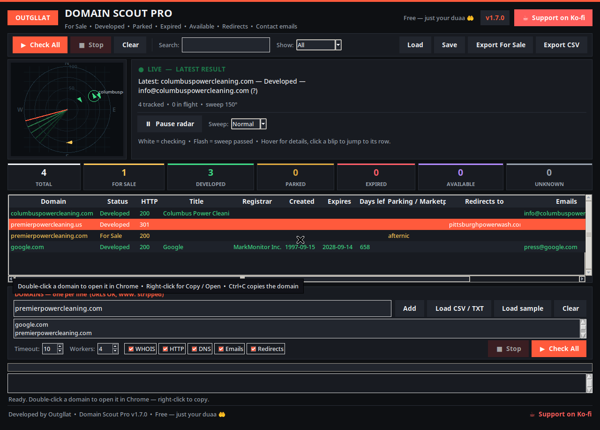

# Domain Scout Pro

Check any domain and tell you, in seconds, whether it is **For Sale, Developed, Parked, Expired, or Available** — with a live radar, redirect tracing, and contact-email finder.

Built by Outgllat. Free to use — just leave a ⭐ if it helps you.



## What it does

Paste a list of domains, hit **Check**, and get one row per domain:

| Status | Meaning |
| --- | --- |
| **FOR SALE** | Listed / parked for sale (Sedo, Afternic, GoDaddy, Dan/Atom, HugeDomains, Bodis, ParkingCrew, etc.) |
| **DEVELOPED** | Live website with real content |
| **PARKED** | DNS / parking page, no clear for-sale wording |
| **EXPIRED** | WHOIS expiry date has passed, or in redemption / pendingDelete |
| **AVAILABLE** | WHOIS says "no match" / not registered |
| **UNKNOWN** | Could not decide (no DNS, blocked, timeout, etc.) |

Plus, per domain:

- **Redirects To** — follows redirects manually (up to 6 hops) and shows the final domain. A cross-domain redirect is usually the real owner site.
- **Emails** — extracts emails actually found on the homepage, then WHOIS, then `/contact`, `/about`. Junk / privacy / noreply addresses are dropped. If none is found and the domain has MX, it shows one clearly-marked guess `info@domain (?)` — `(?)` = unverified.
- **Live radar** — every domain is a live target on the scope: it flies in while being checked, pings when its result lands, and turns the colour of its status. Hover a blip for domain + status, click it to jump to its row.
- **Clickable results** — double-click a domain (or a "Redirects to" value) to open it in Google Chrome, right-click for Open / Copy options, `Ctrl+C` to copy, `Enter` to open.

## How it checks (stdlib only)

1. Normalise + syntax check.
2. **DNS** — A via socket, NS / CNAME via pure-Python UDP DNS (8.8.8.8, then 1.1.1.1), fallback DNS-over-HTTPS, then nslookup. Parking nameservers are a strong for-sale signal.
3. **WHOIS** — port 43. Asks whois.iana.org for the TLD server, follows the referral to the registrar WHOIS, parses registrar / creation / expiry / status / nameservers. For .com/.net falls back to whois.verisign-grs.com.
4. **HTTP** — tries `https://domain` then `https://www.domain` then `http://`, follows redirects manually and records the chain. Reads title + first ~120 KB. Title / body / final URL are scanned for sale + parking keywords and marketplace names.
5. **Emails** — as above.
6. **Classify** — expiry first, then available, then for-sale, then parked, then developed, else unknown.

## Run it

No install needed. Python 3 only, standard library only — no `pip install`.

```bash
python3 domain_scout_pro.py
```

Windows:

```bash
python domain_scout_pro.py
```

Window is 1280×920, results at the top, newest first.

Export results to CSV from the app.

## Honest limits

- It cannot see private marketplace listings. A domain listed on Afternic / Sedo / Dan with a lander this tool cannot distinguish from a normal parked page, and a domain listed only inside a marketplace account (no lander) will look Developed / Parked. Treat FOR SALE as "landed for sale", not "listed everywhere".
- It cannot tell you which *other* domains redirect *to* this one — that needs a backlink / redirect index, not DNS + HTTP. What it shows is the forward direction: where *this* domain sends its visitors.
- WHOIS port 43 is blocked on some networks / VMs, so Expired / Available may show as Unknown there — always re-check on a registrar before buying.
- Gmail / Outlook-style catch-alls and accept-then-bounce mailboxes mean a found email is a lead, not a guarantee.

## Support

Made by Outgllat — https://ko-fi.com/outgllat

## License

MIT — see [LICENSE](LICENSE).
